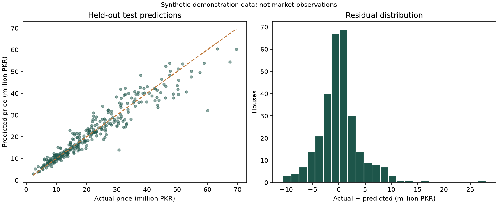

# House Price Prediction

A Python regression portfolio project with a Streamlit interface, reproducible training, data cleaning, and honest held-out evaluation. **The bundled Pakistan-style data is synthetic. Prices and measured errors do not represent Pakistan's housing market.**

## Problem statement
Estimate a property's price from tabular features and assess how far predictions differ from observed targets. This project demonstrates the machine-learning workflow, not a valuation service.

## Features
- Validate numeric ranges and types; handle duplicates, invalid targets, missing features, and unseen categories.
- Train-only median/mode imputation, numeric scaling, and one-hot encoding in Scikit-learn pipelines.
- Compare a median baseline, Ridge regression, and random forest using five-fold training cross-validation.
- Select the lowest cross-validation MAE, then evaluate on a held-out 20% test set.
- Report MAE, RMSE, R², baseline MAE, actual-vs-predicted charts, residuals, and CSV predictions.
- Streamlit single-property prediction, batch prediction, dataset explorer, and evaluation pages.

## Technologies
Python, Pandas, NumPy, Scikit-learn, Matplotlib, Joblib, Streamlit, Pytest. No Node.js or separate frontend server is needed.

## Structure
```text
house-price-prediction/
  app.py                      # Streamlit interface
  train.py                    # CLI training, reports, saved model
  generate_data.py             # Reproducible fictional data generator
  src/data.py                 # Schema validation and deterministic cleaning
  src/modeling.py             # Preprocessing, CV, model selection, evaluation
  data/house_prices.csv        # Included synthetic training data
  data/prediction_template.csv # Example input for batch predictions
  models/                     # Created by training; models are not committed
  reports/                    # Measured metrics, plots, test predictions
  notebooks/house_analysis.ipynb
  tests/test_data.py
  requirements.txt
  requirements-dev.txt
  .streamlit/config.toml
  .gitignore
```

## Windows / VS Code setup
Extract the ZIP, open the extracted project folder in VS Code, and open a PowerShell terminal. Python 3.12 or 3.13 is suitable; check your available versions using `py -0p`. These commands assume Python 3.13 is installed. Run each command only after the previous one finishes successfully.

```powershell
cd D:\house-price-prediction
py -3.13 -m venv .venv
.\.venv\Scripts\python.exe -m pip install -r requirements.txt --timeout 120 --retries 5
.\.venv\Scripts\python.exe train.py
.\.venv\Scripts\python.exe -m streamlit run app.py
```
Open the local URL shown by Streamlit, usually http://localhost:8501. Keep the terminal open. Explicit interpreter paths avoid PowerShell activation-policy errors. On later runs, only the final command is required unless you change the data or environment.

macOS/Linux:
```bash
python3 -m venv .venv
source .venv/bin/activate
pip install -r requirements.txt
python train.py
streamlit run app.py
```

## Dataset schema and units
One row represents one unique property. All prices must use **PKR**, area **square feet**, and distance **km**.

| Column | Description / accepted values |
|---|---|
| property_id | Optional identifier, excluded from modeling |
| area_sqft | 200–20000 |
| bedrooms, bathrooms | Whole numbers, 1–20 |
| age_years | 0–150 |
| parking_spaces | Whole number, 0–10 |
| distance_to_center_km | 0–150 |
| city | Text; demo: Islamabad, Lahore, Karachi, Peshawar, Mardan |
| property_type | Text; demo: House, Apartment |
| condition | Text; demo: Fair, Good, Excellent |
| price_pkr | Positive numeric target; training only |

Missing or invalid features are imputed within each training fold. Missing/invalid targets are removed, never imputed. Duplicate feature vectors are removed before splitting; the first is kept, including when target values conflict. Review such conflicts for real data. Entirely empty feature columns are rejected for training. Real datasets with repeated properties must be deduplicated by property identity before use. The included sample deliberately contains missing features, a negative age, and duplicate rows.

## Use real data
Obtain a legally reusable dataset, document its source, dates, license, units, and collection process, and map its fields to the schema. Do not merely rename columns with incompatible units. Save it as `data/real_houses.csv` and run:
```powershell
.\.venv\Scripts\python.exe train.py --data data/real_houses.csv --source-label "Your source and collection period; prices in PKR"
```
Restart Streamlit after training. Dataset uploads in the explorer are previews, not retraining. The prediction form offers demo categories; update `CATEGORIES` in `src/data.py` for your real dataset. Batch prediction accepts new categories, but their effects cannot be learned without training examples. The explorer defaults to the bundled sample; upload your real CSV to explore it.

## Evaluation and limitations
The test set is never used to select a model. Scalers, encoders, and imputers are fitted within training folds. The saved model remains fitted on the training split, so its predictions match the reported evaluation; it is not silently refitted on all rows. Reports include the input-file SHA-256 and Scikit-learn version. Small numeric changes are possible across package versions.

MAE is the average absolute difference in PKR. RMSE emphasizes larger errors. R² measures improvement relative to a mean reference and may be negative; it is not accuracy. MAE is not an individual confidence interval. Synthetic data follows a programmed relationship, so performance on it cannot establish real-world predictive skill. Spatially related properties or later sales may require grouped or chronological evaluation rather than a random split. Missing location detail, inflation, neighborhood amenities, and sample selection can strongly affect actual housing estimates. Model extrapolation can fail; predictions are not financial advice or appraisals.

Reference: https://scikit-learn.org/stable/common_pitfalls.html

## Test the project
```powershell
.\.venv\Scripts\python.exe -m pip install -r requirements-dev.txt
.\.venv\Scripts\python.exe -m pytest -q
```
Train the model, run the UI, change property details, upload the prediction template, and download the resulting CSV. The evaluation page should match `reports/metrics.json`. The optional notebook uses the same source modules; install Jupyter separately if you want to run it.

## Screenshots and charts
The actual training evaluation chart is included below. Add your own Streamlit screenshots to `docs/screenshots/` after running the application; no simulated UI screenshots are included.



## GitHub
Suggested repository: **house-price-prediction**

Description: Python house-price regression project with data cleaning, Scikit-learn pipelines, cross-validation, MAE/RMSE evaluation, and a Streamlit prediction app.

Create an empty repository on GitHub without adding a README. From the project root:
```powershell
git init
git add .
git status
git commit -m "Add house price prediction project"
git branch -M main
git remote add origin https://github.com/ahadali-codes/house-price-prediction.git
git push -u origin main
```
Check staged files before committing: do not include your virtual environment, secrets, or private datasets. If origin already exists, use `git remote set-url origin URL`. This is one Python application, so use one repository.

## Deployment
For a Streamlit host, install requirements, run `python train.py` as a build/preparation step, then start `streamlit run app.py`. On Streamlit Community Cloud, select the GitHub repository and `app.py`. Because model binaries are ignored, first train locally using the same Python and Scikit-learn versions as the host, then explicitly commit your own trusted generated model with `git add -f models/house_price_model.joblib`, together with its matching reports. Pin the tested package versions for deployment. Never load downloaded or user-uploaded Joblib/Pickle models from untrusted sources. This app only loads its own local artifact.

## Future improvements
Replace fictional data with licensed real sales records, add neighborhood/geographic features, use time-based evaluation, compare tuned boosting methods, assess error by price segment and location, calibrate prediction intervals, and record data/model versions.

## Measured demo results

On 1,500 cleaned synthetic properties with 1,200 training and 300 test rows, the selected model was **Random forest**. Test MAE: **PKR 2,783,639**, RMSE: **PKR 4,140,835**, R²: **0.906**. The median baseline MAE was PKR 10,699,467. These are actual outputs from this run. Random forest had the lowest training CV MAE; this is specific to the programmed synthetic dataset.

## CV description

**House Price Prediction | Python, Pandas, NumPy, Scikit-learn**

Prepared a synthetic housing dataset, built regression pipelines with train-only preprocessing, and evaluated a random forest on an 80/20 split, achieving a test MAE of PKR 2,783,639. GitHub: add your published repository link.
